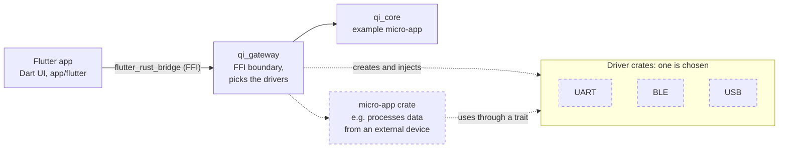

# Flutter + Rust: native application template

A ready starting point for desktop and mobile applications. Flutter renders the UI, Rust contains the application logic, and `flutter_rust_bridge` connects them directly through FFI. Web is not supported.

## Start here

1. [Install the tools and run the application](app/flutter/README.md).
2. [Explore the repository and learn where to make changes](docs/START_HERE.md).
3. [Create a project from the template and rename it](docs/NEW_PROJECT.md).

The repository includes a working `greet` demo. Use it as an example of the Flutter → Rust flow, not as product logic.

## Architecture



Flutter renders the UI and calls Rust only through `qi_gateway`. The gateway exposes the API of the micro-app crates to Dart and contains no business logic. Micro-apps hold the logic and reach hardware only through a trait, so the driver (UART, BLE, USB) can be swapped. The gateway selects the driver crates per platform (`cfg(target_os)`) or per product variant (Cargo features). Micro-app and driver crates can live in `rust/crates/` or be external Cargo dependencies.

`qi_core` is an empty example micro-app. Dashed elements show the intended structure and are not part of the template yet. The gateway's role, API module layout, driver selection, and Rust ↔ Dart type mapping are described in [`rust/crates/qi_gateway/README.md`](rust/crates/qi_gateway/README.md).

## Platforms

| Platform | Flutter project | CI verification | Run/device testing |
| --- | --- | --- | --- |
| Linux | Yes | Required build | Locally on Linux |
| Android | Yes | Build on demand | Android emulator or device |
| iOS | Yes | Simulator build on demand | iOS Simulator or device; a device requires macOS and signing |
| Windows | Yes | Build on demand | Locally on Windows with Visual Studio C++ tools |
| macOS | Yes | No CI build | Locally on macOS with Xcode |
| Web | No | Not **yet** supported | Not supported |

Every push and pull request must pass the Linux build. Anyone with write access can build Android, iOS, or Windows for any branch on demand: Actions tab → **Manual Platform Build** → **Run workflow**, then pick the branch and platform. The same from a terminal with the GitHub CLI:

```bash
gh workflow run manual-build.yml --ref <branch> -f platform=android   # or ios, windows
```

CI builds do not replace testing on physical devices.

The generated `frb_generated.web.dart` file is kept current because FRB emits it; its presence does not mean the application supports Web.

## Quality, testing, and releases

Local quality checks and integration test commands are in the [Flutter guide](app/flutter/README.md) and [testing documentation](testing/README.md). CI also checks that generated FRB bindings are up to date. Do not manually edit `frb_generated*` files or vendored code under `app/flutter/rust_builder/cargokit/`.

Agent rules and architecture are documented in [AGENTS.md](AGENTS.md). The branching and release strategy is in [RELEASES_AND_BRANCHING.md](RELEASES_AND_BRANCHING.md), and the Android Gradle Plugin policy is in [ANDROID_AGP9_MIGRATION.md](app/flutter/ANDROID_AGP9_MIGRATION.md).

For a reproducible Linux/Android toolchain shared by CI and VS Code, see the [development container guide](docs/DEVELOPMENT_CONTAINER.md). Local iOS Simulator builds require macOS and Xcode.

See [CONTRIBUTING.md](CONTRIBUTING.md) before opening a pull request and [SECURITY.md](SECURITY.md) to report a vulnerability privately.

### Committing unused FRB API functions

The pre-commit hook blocks a commit when Rust exposes a function to Dart that the app does not use. CI only warns about it. The hook blocks because editors such as VS Code show hook output only when a commit fails, so a warning would go unnoticed. To commit such a function on purpose, commit from a terminal with the flag:

```bash
FRB_ALLOW_UNUSED=1 git commit
```

For a function that should stay unused for longer, add `/// frb-api-usage: allow-unused (<reason>)` to its Rust doc comment instead. Then there is no warning, and a normal commit passes, also from the VS Code commit button.

## Markdown files

This table lists the repository's Markdown files and explains who they are for. **Human** means primarily for developers; **AI** means primarily for coding agents; **Both** means useful to either audience. Some files are upstream or tool-generated documentation and are only relevant when working in that specific folder.

| File | Audience | Purpose |
| --- | --- | --- |
| [`README.md`](README.md) | Both | Repository overview, supported platforms, and links to the main guides. |
| [`AGENTS.md`](AGENTS.md) | Both | Source of truth for architecture, platform limits, development rules, and quality checks; agents should read it before changing code. |
| [`CLAUDE.md`](CLAUDE.md) | AI (Claude Code) | Tells Claude Code to follow `AGENTS.md` and explains how to treat the repository's AI workflow references. |
| [`GEMINI.md`](GEMINI.md) | AI (Gemini) | Gemini-specific project instructions and links to task workflows. |
| [`AI_TOOLS_HELPERS.md`](AI_TOOLS_HELPERS.md) | Both | Explains the AI roles and skills stored under `.gemini/` and how to use them. |
| [`CONTRIBUTING.md`](CONTRIBUTING.md) | Human | Contribution expectations, review guidance, and checks to run before opening a pull request. |
| [`SECURITY.md`](SECURITY.md) | Both | Describes how to report vulnerabilities privately and the template's supported maintenance scope. |
| [`RELEASES_AND_BRANCHING.md`](RELEASES_AND_BRANCHING.md) | Both | Branching conventions and the tag-driven release process. |
| [`app/flutter/README.md`](app/flutter/README.md) | Human | Beginner setup guide for prerequisites, running the Flutter app, platform builds, and troubleshooting. |
| [`app/flutter/ANDROID_AGP9_MIGRATION.md`](app/flutter/ANDROID_AGP9_MIGRATION.md) | Both | Records the Android Gradle Plugin and Kotlin version policy and guidance for a future AGP 9 migration. |
| [`app/flutter/ios/Runner/Assets.xcassets/LaunchImage.imageset/README.md`](app/flutter/ios/Runner/Assets.xcassets/LaunchImage.imageset/README.md) | Human | Brief instructions for replacing the iOS launch-screen images. |
| [`app/flutter/rust_builder/README.md`](app/flutter/rust_builder/README.md) | Human | Notes that this directory is build glue for compiling Rust with Flutter and should generally be left alone. |
| [`app/flutter/rust_builder/cargokit/build_tool/README.md`](app/flutter/rust_builder/cargokit/build_tool/README.md) | Human | Upstream Cargokit sample-project documentation kept with the vendored build tool. |
| [`rust/crates/qi_gateway/README.md`](rust/crates/qi_gateway/README.md) | Both | Role of the FFI gateway crate, API module layout, driver selection, Rust ↔ Dart type mapping, and the allow-unused marker. |
| [`docs/START_HERE.md`](docs/START_HERE.md) | Human | Repository map for beginners, showing where UI, Rust logic, bridge APIs, and tests belong. |
| [`docs/NEW_PROJECT.md`](docs/NEW_PROJECT.md) | Human | Steps for creating a product repository from this template and renaming its packages and native identifiers. |
| [`docs/DEVELOPMENT_CONTAINER.md`](docs/DEVELOPMENT_CONTAINER.md) | Human | Instructions for using the shared Linux/Android toolchain in CI and the VS Code Dev Container. |
| [`scripts/README.md`](scripts/README.md) | Human | Beginner guide to the helper scripts, the temporary directories they create, and how CI uses them. |
| [`testing/README.md`](testing/README.md) | Both | Local quality commands, CI platform coverage, and manual device/integration testing guidance. |
| [`design/README.md`](design/README.md) | Both | Explains the design workspace layout and where future design tokens and component references belong. |
| [`design/docs/agent-workflow.md`](design/docs/agent-workflow.md) | AI | Workflow for agents making design-system, token, reusable-widget, or Widgetbook changes. |
| [`design/figma/README.md`](design/figma/README.md) | Human | Setup notes for using Figma as the design source. |
| [`design/penpot/README.md`](design/penpot/README.md) | Human | Setup and operating guidance for using Penpot as the design source. |

## License

This template does not include a license. Choose and add one before distributing a product created from it; see [new project setup](docs/NEW_PROJECT.md).
